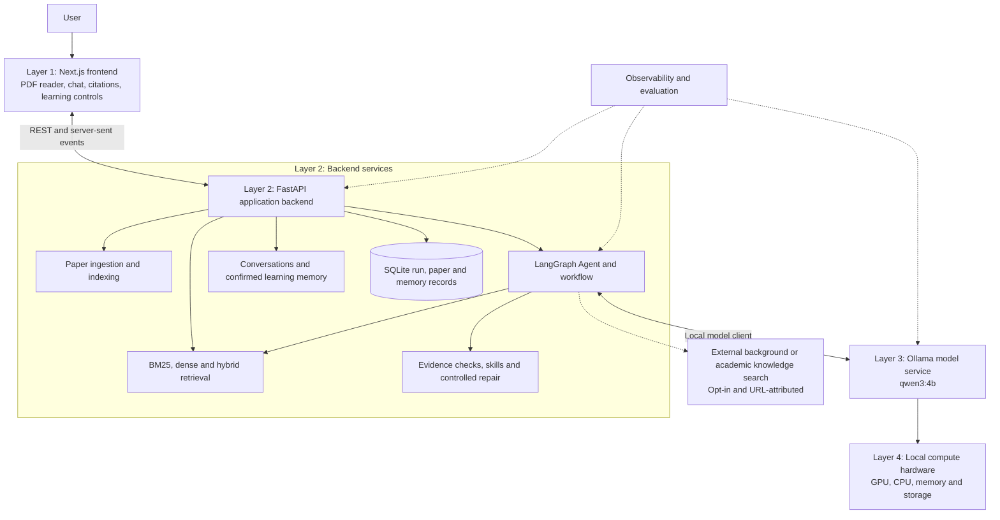

# Architecture and Implementation

## 1. Four-layer design

**Deployed configuration:** local Windows workstation, Ollama-hosted Qwen3:4b, local Python backend and Next.js frontend. The model-client boundary supports a future self-hosted OpenAI-compatible service, but **vLLM/TACC was not deployed or benchmarked in this phase**. The embedding stack uses Sentence Transformers and FAISS, with an optional cross-encoder reranker.

## 2. Knowledge scopes versus execution strategies

These concepts are intentionally separate:

| Dimension | Options | Meaning |
| --- | --- | --- |
| Knowledge scope | Paper QA | Answer from indexed papers; PDF evidence is authoritative for paper claims |
| Knowledge scope | General Learning | Explain concepts without a selected paper; use external URL sources |
| Execution strategy | Basic RAG | One dense retrieval round |
| Execution strategy | Hybrid RAG | One BM25/dense fusion round |
| Execution strategy | Adaptive Agentic RAG | Question analysis, bounded retrieval, evidence assessment, skills and recovery |

General Learning currently uses an Adaptive-oriented explanation workflow. This is **not** a fourth benchmarked retrieval algorithm. For Paper QA, academic web search can provide supplementary context, but a web page is never treated as a passage from the uploaded PDF.

## 3. Data and evidence flow

1. **Ingestion.** Uploaded PDFs are parsed, split into passages and indexed with page references. Original QASPER JSON can be imported as structured text, preserving source paragraph IDs without inventing PDF pages.
2. **Retrieval.** BM25 supports lexical search; Sentence Transformers supports dense similarity; Hybrid fuses ranked results. Adaptive may perform additional retrieval rounds, which adds both retrieval and LLM cost.
3. **Evidence assessment.** The Agent checks whether available passages can answer the question and, when permitted, may retrieve additional evidence.
4. **Answer generation.** A local Qwen model composes the response. Skills supply a task-specific response contract, such as an introductory explanation or a claim-by-claim verdict.
5. **Validation and recovery.** Checks distinguish cited facts from hypothetical numeric examples, inspect direct definitions and citation attribution, and may attempt bounded repair. The system can return `partial` rather than inventing a supported answer.
6. **Presentation.** The frontend shows the result, Agent activity, PDF excerpt buttons or external links, and a run-details view.

## 4. Skills and memory

The repository contains file-backed `SKILL.md` instructions for eight named skills: `explainForBeginner`, `explainFormula`, `verifyClaims`, `guidePaperReading`, `comparePapers`, `suggestLearningPath`, `constructCounterexample`, and `explainBackgroundConcept`. They are reusable **instructions and validation contracts**, not eight autonomous processes.

Learning memory is explicitly confirmed by the user. The app stores a learning profile and notes separately from document facts; turning memory off prevents retrieval of those saved notes. Learning preferences and memory availability must be controlled when designing fair mode comparisons.

## 5. Model service and hardware boundary

The FastAPI Agent calls a model-client abstraction; the Ollama service performs neural inference. This separation permits future changes to serving infrastructure without rewriting the Agent's business logic. The currently evaluated model is `qwen3:4b`, hosted locally. CPU-based embedding initialization is independent of whether model inference uses a GPU. No claim is made about TACC hardware performance, GPU utilization, serving throughput, or distributed scheduling.

## 6. Observability and trust boundaries

- Per-run IDs connect model calls, retrieval strategies, selected evidence, validation attempts, latencies and final status.
- SQLite persists papers, conversations, answers, run state and confirmed learning notes; logs are local.
- QASPER gold labels belong to evaluation tables and are not allowed in runtime retrieval or prompt context.
- External URL sources and PDF passage sources use different citation types.
- The application has no production authentication or secure Internet-facing deployment protections.

## 7. Implementation map

| Path | Responsibility |
| --- | --- |
| `frontend/app/page.tsx` | Main interactive application |
| `frontend/components/PdfReader.tsx` | PDF reading and navigation |
| `backend/app/main.py` | HTTP API and lifecycle |
| `backend/app/knowledge/ingest.py` | PDF/QASPER import |
| `backend/app/knowledge/retrieval.py` | Lexical, dense and hybrid retrieval |
| `backend/app/agent/workflow.py` | Agent flow and answer validation |
| `backend/app/agent/background_learning.py` | External background learning source selection |
| `backend/app/agent/model.py` | Ollama and compatible LLM client |
| `backend/app/skills/` | Skill registry and source-grounding checks |
| `backend/app/evaluation.py` | Offline quality metrics |
| `backend/app/benchmark.py` | QASPER batch runs |
| `backend/app/db.py` | SQLite persistence |

## 8. Future work, not part of this submission

TACC-hosted GPU serving, vLLM deployment, distributed queues, robust OCR/figure reasoning, production user authentication, large-scale benchmarks, and automatic memory extraction are explicitly out of current scope.
